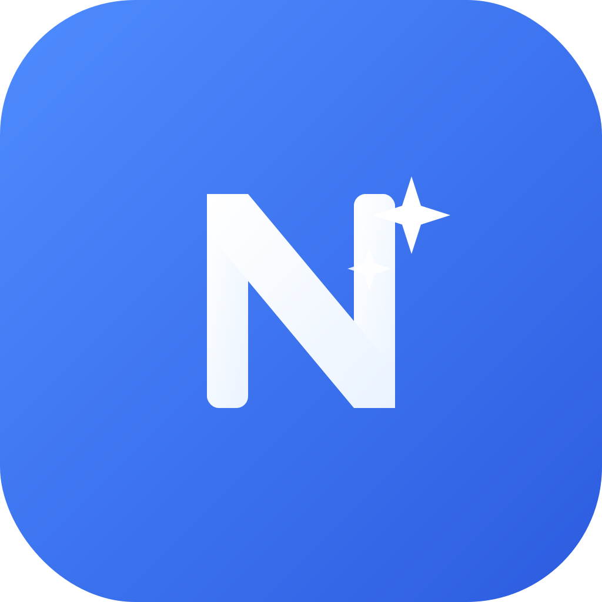
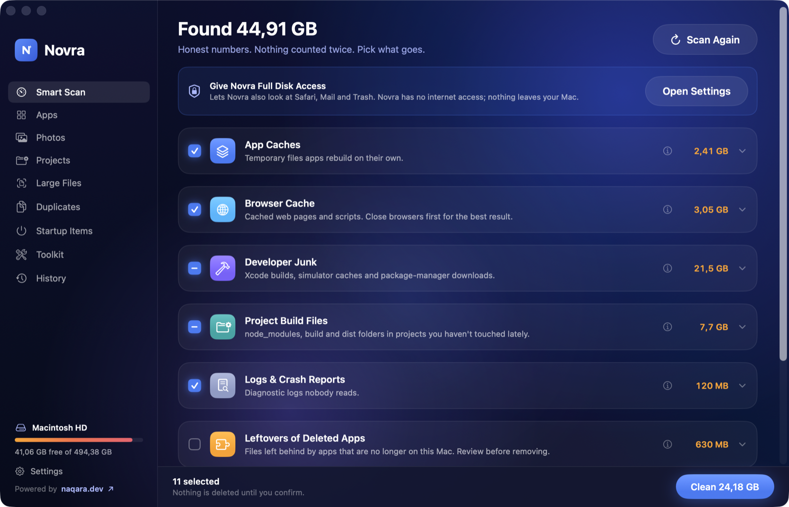
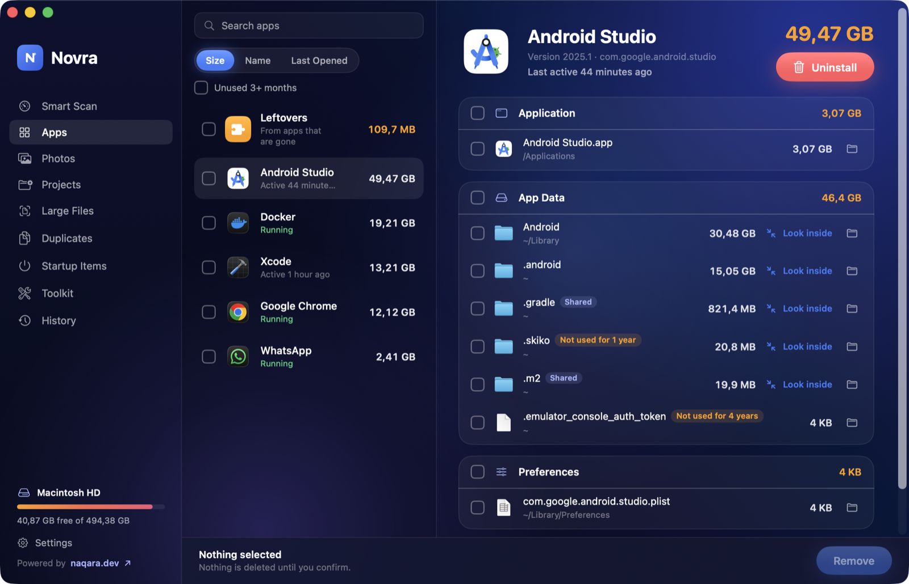
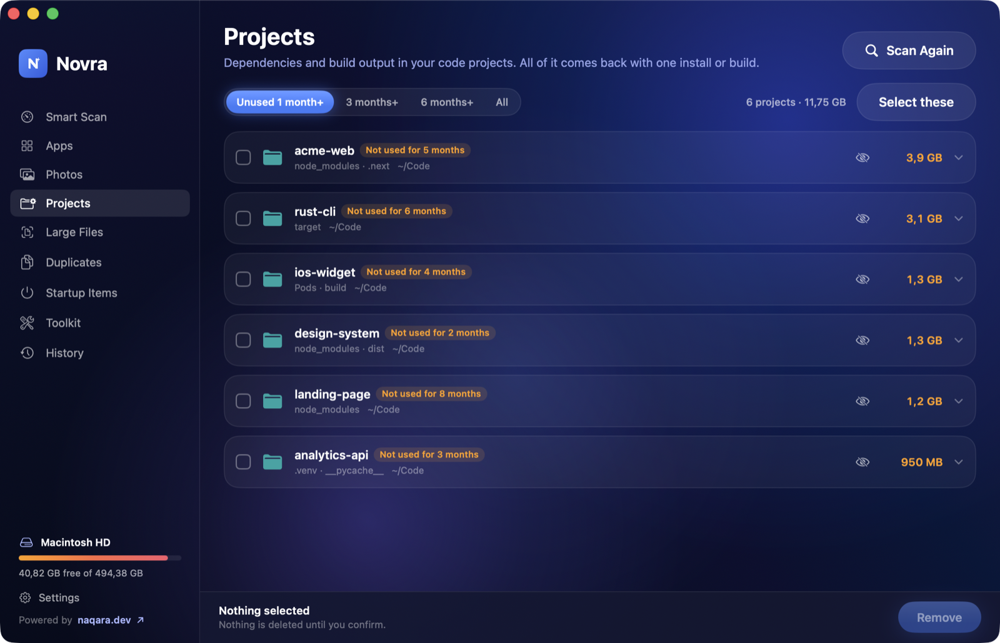
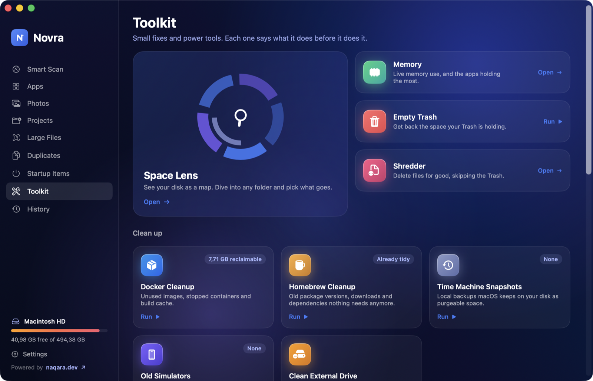
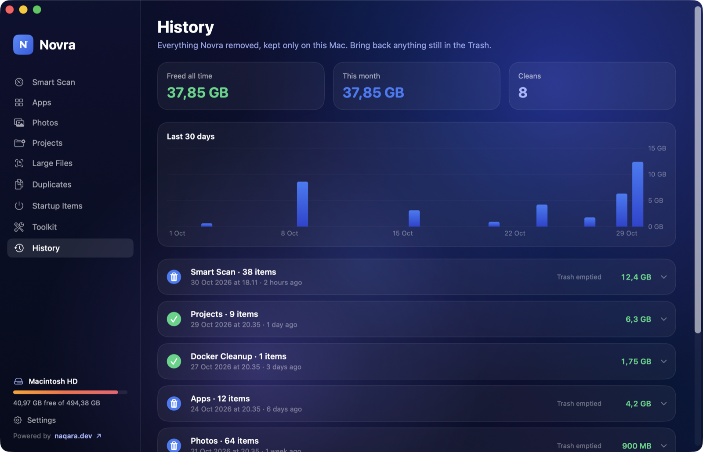

<p align="center">
  
</p>

<h1 align="center">Novra for Mac</h1>

<p align="center">
  <b>Novra finds it. You decide what goes.</b><br>
  A free, open-source Mac cleaner that shows you exactly what's taking space, what each thing is for,<br>
  and what happens if you remove it. Nothing is deleted until you confirm.
</p>

<p align="center">
  
  
  
  
</p>

<p align="center">
  
</p>

Novra is also on Android: [naqara.dev/apps/novra](https://naqara.dev/apps/novra/).

## Why another cleaner?

Most cleaners show one big number and a big button. Novra shows you the list behind the number:

- **Honest numbers.** Every row has a real size, and nothing is counted twice across categories.
- **You see what it is.** Each category explains what will change if you clean it. For example, clearing browser cache keeps you signed in.
- **Reversible by default.** Removals go to the Trash. History records every clean, so you can restore anything that's still in the Trash.
- **Knows when something is in use.** "Unused" is based on when files were last *read*, not only changed. Running apps show as running. Android SDK images are checked against your emulators, and helpers are checked against the daemons that launch them.
- **Private.** Novra makes no network requests: no analytics, no telemetry, no update pings.

## Features

| | |
|---|---|
| **Smart Scan** | App, browser and developer caches (Xcode, Gradle, npm, Homebrew, pip, Cargo, and about 30 more), logs, leftovers of deleted apps, old installers, Mail attachments, system junk, `.DS_Store` files, old CLI versions and Trash, in one pass. |
| **Apps** | Shows every file an app keeps around your Mac. Uninstall it completely, or **look inside** big folders and remove only parts, such as unused Android emulator images or old Xcode device support. |
| **Projects** | Finds `node_modules`, `.next`, `build`, `target`, `.venv`, `Pods` and other build folders in code projects you haven't run in a while. Source code is never touched, and anything tracked by git is skipped. |
| **Photos** | Similar shots (keeps the sharpest), blurry and dark photos, screenshots and large videos, from your Photos library or from folders. Includes **Swipe to Clean** (← delete, → keep, ⌘Z undo) and **video compression** to HEVC. |
| **Large Files & Duplicates** | Finds the biggest files in your home folder, and byte-for-byte duplicates. One copy of each duplicate is always kept. |
| **Startup Items** | Launch agents, daemons and privileged helpers, with orphans flagged. |
| **Toolkit** | Space Lens disk map, live memory, Docker / Homebrew / Nix cleanup, Time Machine snapshots, old simulators, Flush DNS, Reindex Spotlight, repair preferences, compact Mail/Safari/Messages, external drive cleanup, Shredder, and more. Each tool shows a live log of what it does. |
| **History** | Everything removed, how much space came back, and one-click restore. |
| **Menu bar** | Optional disk and memory panel with Quick Clean, plus a low-disk warning. |

The app is available in English and Bahasa Indonesia.

<p align="center">
  
  
  
  
</p>

## Install

**Download:** grab the latest `.dmg` from [Releases](https://github.com/Naqara-Dev/novra/releases), open it, and drag Novra to Applications.

**Build from source:** you need Xcode 16 or newer.

```sh
git clone https://github.com/Naqara-Dev/novra.git
cd novra
open Novra.xcodeproj   # then press ⌘R
```

Or from the command line:

```sh
xcodebuild -project Novra.xcodeproj -scheme Novra -configuration Release -derivedDataPath build build
open build/Build/Products/Release/Novra.app
```

## Permissions, and why

| Permission | Used for | Required? |
|---|---|---|
| Full Disk Access | Reading Safari, Mail, Messages, Trash and sandboxed app caches | No. Without it, Novra finds less. |
| Photos | Finding similar, blurry and dark photos in your library | Only for the Photos library |
| Automation (Finder) | Moving items that need your password to the Trash, and emptying the Trash | Only when needed |
| Administrator password | System logs and caches outside your home folder, and some Toolkit tasks | Asked by macOS each time |

Novra is not sandboxed. A cleaner can't see other apps' caches from inside a sandbox, so it can't be distributed through the Mac App Store.

## How deletion stays safe

- All removal goes through one file: [`Novra/Core/Cleaner.swift`](Novra/Core/Cleaner.swift). It refuses protected locations, including `/`, `/System`, your home folder itself, `~/Documents`, `~/Library`, Keychains and `/Volumes`. Outside your home folder, it only removes items inside a short list of known log and cache folders.
- When a folder and something inside it are both selected, only the folder is removed and counted.
- Cloud placeholders (iCloud Drive, Dropbox, and so on) are never read, so scanning doesn't trigger downloads.
- Anything you mark with **Ignore** is never shown again (Settings › Ignore List).

These rules have tests:

```sh
./scripts/test.sh
```

## Project layout

```
Novra/
  Core/          Cleaner (all deletion), sizing, history, settings, shell, globbing
  UI/            Theme, shared components, motion
  Features/
    SmartScan/   JunkScanner, CleanupRules (path rules), ProjectScanner, ExtraScanners
    Uninstaller/ AppCatalog (files ↔ apps), Apps page, folder explorer, path hints
    Photos/      Analysis (Vision), Swipe to Clean, video compression
    Projects/ LargeFiles/ Duplicates/ Startup/ Toolkit/ History/ Settings/ MenuBar/ Onboarding/
Tests/           CoreTests.swift (run with scripts/test.sh)
scripts/         test.sh, release.sh, translations_id.py
```

Most cleanup targets are plain data in [`CleanupRules.swift`](Novra/Features/SmartScan/CleanupRules.swift). To add one, write a path pattern, a name and a one-line note about what it is. That's usually all it takes.

## Contributing

Issues and pull requests are welcome. Some useful starting points:

- **New cleanup targets:** add a `CleanupRule`, with a note that tells people what they lose.
- **Translations:** run a build, then `xcrun xcstringstool sync Novra/Localizable.xcstrings --stringsdata $(find build -name '*.stringsdata')`. Add translations to a script like [`scripts/translations_id.py`](scripts/translations_id.py).
- **Screenshots:** Debug builds accept `-demo YES`, which fills pages with made-up data so no real files appear in images.

Before opening a PR, please run `./scripts/test.sh` and test any deletion change on a scratch folder.

## Releasing

`./scripts/release.sh` builds a DMG. With `DEVELOPER_ID` and `NOTARY_PROFILE` set, it also signs, notarizes and staples it. See the comments at the top of the script.

## Credits

- Many cleanup targets were cross-checked against [Mole](https://github.com/tw93/mole) by tw93. Thanks for mapping out where macOS hides its junk.
- Built by [Naqara Dev](https://naqara.dev).

## License

[MIT](LICENSE) © 2026 Naqara Dev
